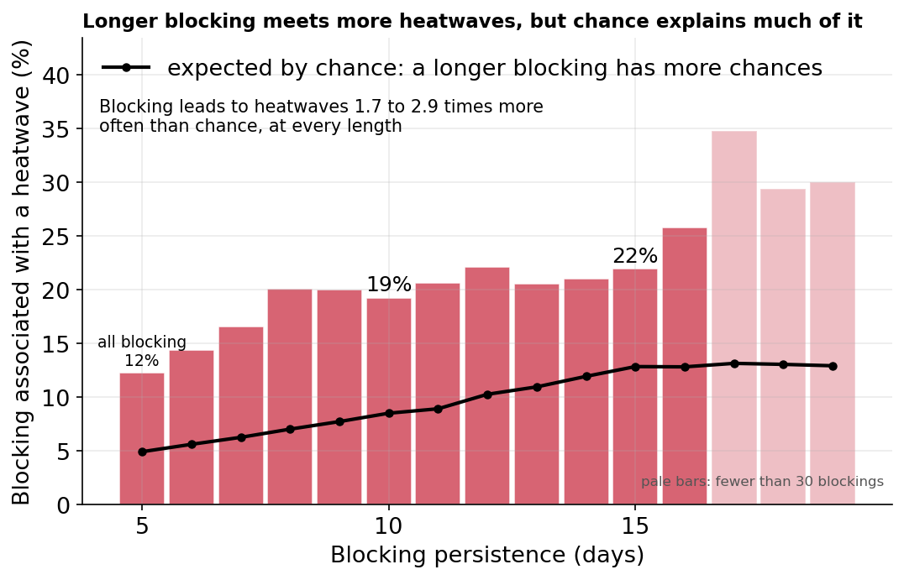
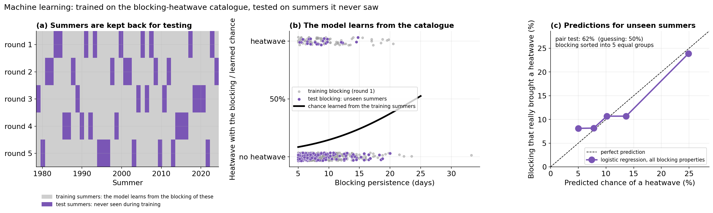
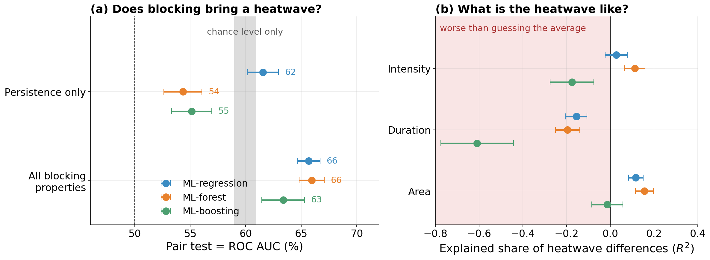
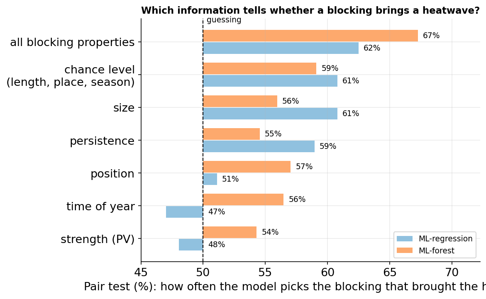

# From blocking to heatwave: does blocking persistence matter for heatwave occurrence?
A simple machine-learning (ML) diagnostic study of Northern Hemisphere summer blocks and heatwaves (ERA5 reanalysis, June–August, 1979–2025).

## Question

Blocking often triggers heatwaves, and its persistence is ambiguously known to play the key role for heatwaves.
If we know the properties of blocking, can we predict the heatwave?

1. **Heatwave occurrence:** which blocking property tells whether a heatwave occurs?
2. **Heatwave properties:** if one occurs, how intense, long and large is it?


Simple ML models are trained with blocking properties that are linked to heatwaves. Once trained, they predict
the heatwave from blocking properties only: persistence, size, strength (upper-level negative PV anomaly),
position and time of year. The blocking is assumed known, as if it came from a forecast or a climate
projection ("perfect prognosis").

## Data

From *The link between blocking characteristics and heatwaves*,
https://doi.org/10.5281/zenodo.23714803 (see there how heatwaves and blocking are associated).
Heatwaves and blocking are detected with a quasi-Lagrangian contour-tracking algorithm
(https://doi.org/10.5281/zenodo.23556794).

Files in `data/`:
- `blocking_catalogue.csv`: blocking and its properties
- `heatwave_block_association.csv`: heatwaves and their properties, with their associated blocking

## Run

````bash
pip install -r requirements.txt
python 1_block_table.py            # each blocking, with the heatwave(s) it brought
python 2_does_duration_matter.py   # the chance level, the ML models and four figures
python 3_predict_date.py           # pick a date: the blocking around it and the predicted heatwaves
```` 

In `3_predict_date.py`, change `DATE` to any summer date:

````python
DATE = '2021-06-27'                  # the date to look at (YYYY-MM-DD)
````

The first run of `2_does_duration_matter.py` takes about a minute longer, because the chance level of every
blocking is computed. It is then saved in `data/block_chance.csv`.

## ML models, in simple words (for beginners like me): two ML are used

- **ML-multivariate regression** finds the best formula: a·x + b·y + c·z + … = heatwave property, where
  x, y, z are blocking properties and a, b, c are numbers learned during training. For yes/no
  (does a heatwave occur?) it gives a chance between 0 and 100% (logistic regression); for
  numbers (intensity, duration, area) it gives a value (linear regression).
- **ML-forest** (random forest) asks yes/no questions, such as "Does the blocking last more than
  10 days? Is it north of 60°N?". Each chain of answers ends in a group of similar past blocking.
  It averages 500 such question trees.
- **Fair test.** The models learn from some summers and are tested on summers they never saw (Figure 2).
- **Pair test.** The model sees two blocking, one that is associated to a heatwave and one that did not, and
  must say which is which. Guessing is right half of the time (50%).
- **Chance level.** For every blocking, we count how often it would meet a heatwave if heatwaves happened at
  their usual times and places but had nothing to do with that blocking. Each blocking is paired with the
  heatwaves of the *other* summers: realistic, but unrelated to it. A longer blocking meets more of them
  just because it lasts longer.
- **ML-boosting** (gradient boosting) builds small trees one after the other, each one correcting the mistakes
  of the previous ones. It is used as a third check and is not better than the forest here.

## Results

**1. The more persistent the blocking, the more likely a heatwave, but chance explains much of it.** Only 13%
of summer blocking comes with a heatwave. This rises from 6% for blocking up to 6 days to 26% for blocking
over 15 days. A longer blocking has more chances to meet a heatwave, and the chance level rises too, from 3%
to 13%. Blocking meets a heatwave 1.9 to 3.0 times more often than chance at every length, and this factor
does not increase with persistence: a longer blocking is not more heatwave-prone than its length alone implies.

| Blocking lasting | Blocking | With a heatwave | Expected by chance | Observed / chance |
|---|---|---|---|---|
| up to 6 days | 250 | 6% | 3% | 2.0 |
| 6 to 10 days | 390 | 14% | 5% | 3.0 |
| 10 to 15 days | 117 | 18% | 7% | 2.5 |
| over 15 days | 39 | 26% | 13% | 2.0 |



**2. How the model is trained and tested.** Whole summers are kept back for testing (a). The model learns the
chance of a heatwave from the training blocking (b), and is then tested on blocking from summers it never saw
(c). The predicted chances match what really happened.



**3. Persistence tells whether a heatwave occurs, but so does the chance level.** All scores are the mean
and spread over 30 different splits of the summers (Figure 3, left). Knowing only the persistence, the models pick
the right blocking in 62 ± 1.4% (ML-regression) and 54 ± 1.7% (ML-forest) of pairs; guessing gives 50%.
The chance level alone gives about 60%, and adding persistence to it raises the score by +3.6 points
for the regression (95% range +0.6 to +6.7) and cannot be told apart from zero for the forest (−2.9 to +8.8).
All blocking properties together give 66% for both ML-regression and ML-forest; ML-boosting gives 63 ± 1.9%.
Taken one at a time (best of the two models), size (61%), persistence (59%) and position (57%) tell the most;
time of year (56%) and strength (PV anomaly, 54%) little. Size and persistence are partly built into the
association: a larger blocking has a larger circle, and a longer blocking more time steps, to meet a heatwave.




**4. Blocking properties do not tell us how severe the heatwave is.** Persistence alone explains nothing of the
heatwave's intensity, duration or area. All blocking properties together explain about 11% of the intensity
and 16% of the area (ML-forest), and nothing of the duration (Figure 3, right). ML-boosting is worse than
guessing the average. The heatwave looks the same whatever the blocking persistence: the median duration is
about 5 days in every persistence class.
 
| North American blocking | ML prediction | Real (ERA5) |
|---|---|---|
| Chance of a heatwave | 27% (highest of the 3) | heatwave occurred |
| Heatwave intensity | 11.0 K | 11.9 K |
| Heatwave duration | 5.8 days | 8.25 days |

*Of the three blocking active that day, the other two (Atlantic, 14% and 6%) brought no heatwave.*

## Settings

No hyperparameter tuning was done. Models use scikit-learn defaults except where listed.
All settings are in `common.py`.

| | Setting |
|---|---|
| ML-regression, yes/no (does a heatwave occur?) | Logistic regression, inputs standardised, `max_iter=1000`, default L2 penalty (C = 1) |
| ML-regression, numbers (intensity, duration, area) | Linear regression, inputs standardised |
| ML-forest (classifier and regressor) | 500 trees, at least 5 blocking per leaf, `random_state=42` |
| ML-boosting (classifier and regressor) | Gradient boosting, trees of depth 3, learning rate 0.05, 200 steps, at least 10 per leaf |
| Fair test | 5 groups of summers; whole summers are held out together. Repeated with 30 different splits |
| Blocking properties used | persistence, size, strength (min PV), latitude, longitude (sine and cosine), day of year |
| Heatwave properties predicted | occurrence (yes/no), maximum intensity, duration, maximum area |
| Chance level | Simplified association rule: circles enlarged by 1.2, blocking seen 1–2 days before the heatwave, at least 4 six-hourly steps of overlap |
| Uncertainty | Spread over the 30 splits; bootstrap over blockings, 500 resamples (gain from adding persistence to the chance level) |

Only 98 blocking events came with a heatwave, so the settings are kept simple to avoid fitting noise.


## Blocking to heatwaves!!!
Blocking persistence, together with other block properties, helps to tell *whether* a heatwave
occurs, but not how severe it is: how long, how large or how intense. Predicting these needs more
inputs, such as soil moisture, land-surface feedbacks, subtropical ridges and other local
processes.

## Limitations and next steps

- The catalogues depend on the detection settings (thresholds, overlap, persistence).
- The block is assumed known. A real forecast has errors.
- More persistent blocks have more time to meet a heatwave by chance, so part of result 1 is
  expected. The paper tests this for blocked days with the blocks of other years.
- Only about 120 blocks came with a heatwave, so the heatwave results are rough.
````
````

