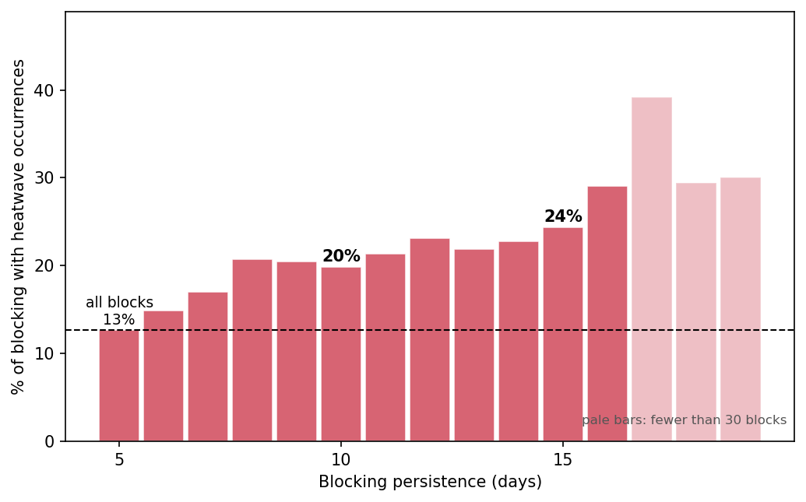
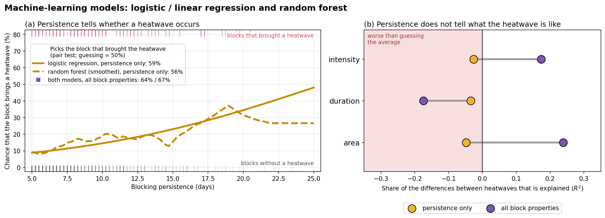
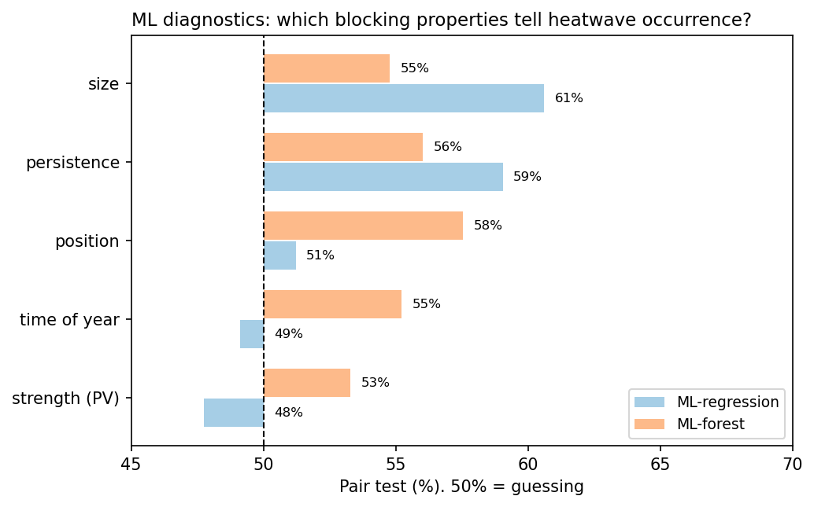
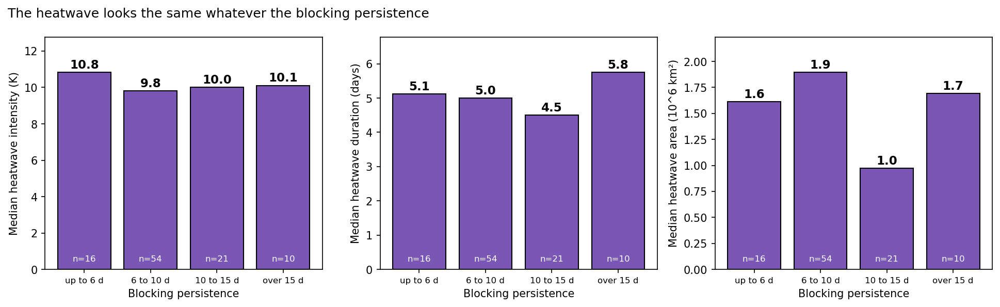

# From blocking to heatwave: does blocking persistence matter for heatwave occurrence?
A simple machine-learning (ML) diagnostic study of Northern Hemisphere summer blocks and heatwaves
(ERA5 reanalysis, June–August, 1979–2025).

## Question

Blocking often triggers heatwaves, its persistences is ambigiously known to play the key role for heatwaves. If we know the properties of blocking, can we predict the heatwave?

1. **Heatwave occurrence:** which blocking property tells whether a heatwave occurs?
2. **Heatwave properties:** if one occurs, how intense, long and large is it?

A simple ML models is trained with block properties that are linked to heatwaves. Once trained, they predict the heatwave from blocking properties only: persistence, size, strength (upper level negative PV anomaly), position and time of year. The block is assumed known, as if it came from a forecast or a climate projection ("perfect prognosis").

## Data

From *The link between blocking characteristics and heatwaves*,
https://doi.org/10.5281/zenodo.23714803 (see there how heatwaves and blocks are associated).
Heatwaves and blocks are detected with a quasi-Lagrangian contour-tracking algorithm
(https://doi.org/10.5281/zenodo.23556794).

Files in `data/`:
- `blocking_catalogue.csv`: blocks and their properties
- `heatwave_block_association.csv`: heatwaves and their properties, with their associated blocks

## Run

````bash
pip install -r requirements.txt
python 1_block_table.py            # each block, with the heatwave(s) it brought
python 2_does_duration_matter.py   # a basic count, then the ML models
python 3_predict_date.py           # pick a date: the blocks around it and the predicted heatwaves
````

In `3_predict_date.py`, change `DATE` to any summer date.

## ML models, in simple words (for beginners like me): two ML are used

- **ML-mutilvariate regression** finds the best formula: a·x + b·y + c·z + … = heatwave property, where
  x, y, z are block properties and a, b, c are numbers learned during training. For yes/no
  (does a heatwave occur?) it gives a chance between 0 and 100% (logistic regression); for
  numbers (intensity, duration, area) it gives a value (linear regression).
- **ML-forest** (random forest) asks yes/no questions, such as "Does the block last more than
  10 days? Is it north of 60°N?". Each chain of answers ends in a group of similar past blocks.
  It averages 500 such question trees.
- **Fair test.** The models learn from some summers and are tested on summers they never saw.
- **Pair test.** The model sees two blocking, one that is associated to heatwave and one that did not, and
  must say which is which. Guessing is right half of the time (50%).

## Results

**1. The more persistent the block, the more likely a heatwave.** Only 15% of summer blocks come with a heatwave. This rises from 8% for blocks up to 6 days to 31% for blocks over 15 days.


**2. Persistence tells whether a heatwave occurs, but it doesnot tells us the properties of heatwave.** Knowing only the persistence, the models pick the right block in 59% (ML-regression) and 56% (ML-forest) of pairs;
guessing gives 50%. Knowing all block properties raises this to 64% and 68%. Persistence of blocking can not give any useful information regarding the heatwave's intensity, duration or area. All block properties together explain about 17% of the intensity and 24% of the area, and nothing of the duration.



**3. Which blocking property tells heatwave occurrence?** Taken one at a time, size (61%), persistence (59%) and position (58%) tell the most; time of year (55%) and strength (PV anomaly, 53%) little. Size and persistence are partly built into the association: a larger block has a larger circle, and a longer block more time steps, to meet a heatwave.



**4. The heatwave looks the same whatever the blocking persistence.** The median duration is
about 5 days in every persistence class.


**Predict the heatwave: 27 June 2021.** Of the three blocks active that day, the model gave the highestchance  (38%) to the block over North America, the one that brought the Pacific Northwest heatwave. The heatwave was west of the block, a non-local link. The Atlantic block (16% chance) also brought a heatwave, a long one of 14 days.

| No. | Block ID | Dates | Lat | Lon | Region | Persistence (d) | Size (10⁶ km²) | PV | Heatwave chance | Expected intensity (K) | Expected duration (d) | ERA5 heatwaves | ERA5 intensity (K) | ERA5 duration (d) |
|---|---|---|---|---|---|---|---|---|---|---|---|---|---|---|
| 1 | 58334 | 22 Jun–6 Jul | 59°N | 11°W | Europe | 14.75 | 4.0 | −1.9 | 14% | 9.4 | 5.7 | 0 | – | – |
| 2 | 58373 | 23–28 Jun | 80°N | 11°W | Europe | 5.50 | 0.9 | −1.6 | 6% | 8.2 | 5.8 | 0 | – | – |
| **3** | **58390** | **24 Jun–12 Jul** | **58°N** | **81°W** | **North America** | **18.50** | **4.4** | **−2.0** | **27%** | **11.0** | **5.8** | **1** | **11.9** | **8.25** |

*PV = most negative PV anomaly. Expected = if a heatwave comes.*


## Blocking to heatwaves!!!
Blocking persistence, together with other block properties, helps to tell *whether* a heatwave
occurs, but not how severe it is: how long, how large or how intense. Predicting these needs more
inputs, such as soil moisture, land-surface feedbacks, subtropical ridges and other local
processes.

## Limitations and next steps

- The catalogues depend on the detection settings (thresholds, overlap, persistence).
- The block is assumed known. A real forecast has errors.
- More persistent blocks have more time to meet a heatwave by chance, so part of result 1 is
  expected. The paper tests this for blocked days with the blocks of other years.
- Only about 120 blocks came with a heatwave, so the heatwave results are rough.
````
````
